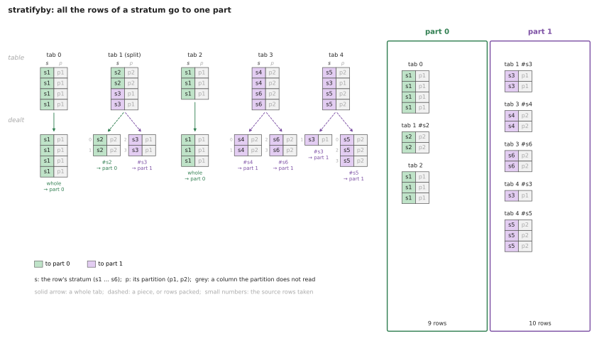
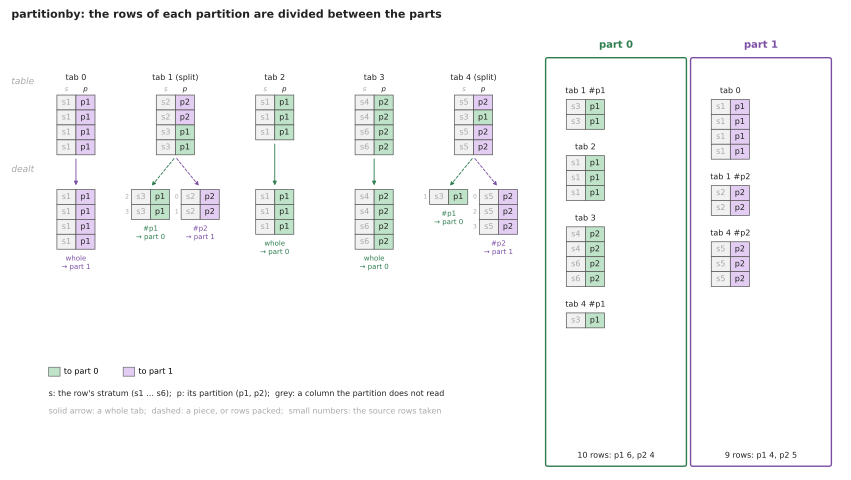
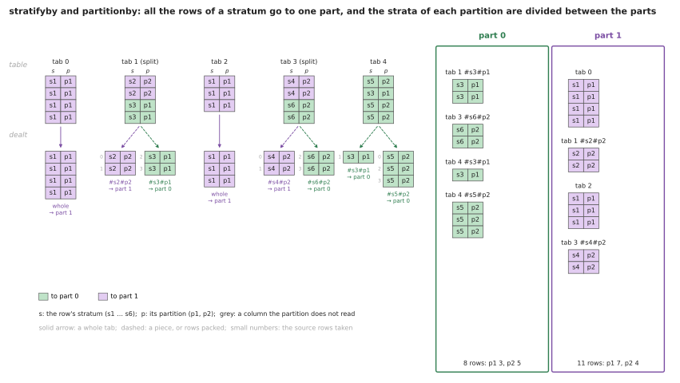
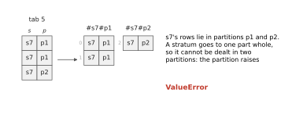
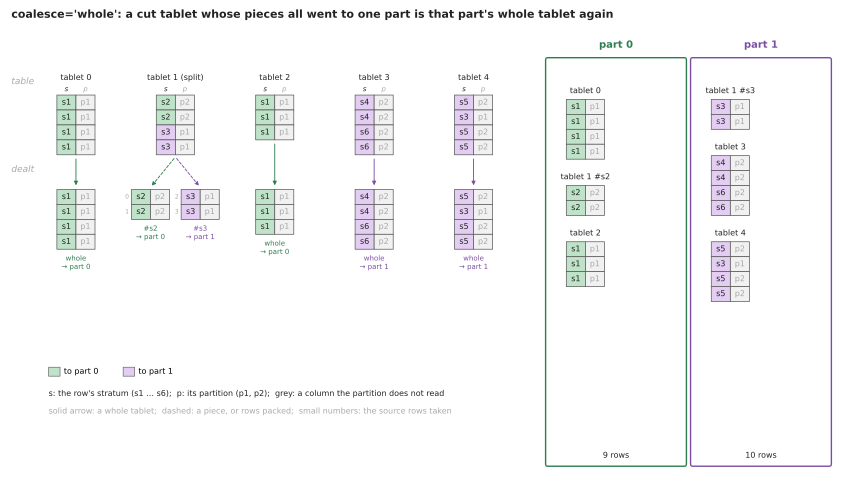
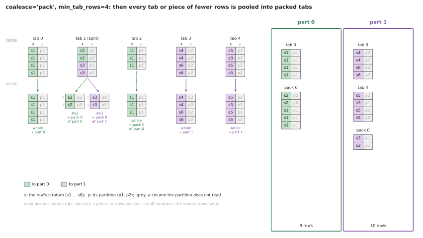

# Partitions, parts and pieces

## At a glance

### Three roles

- **A partition** decides which rows go to which part -- every part at once, the parts
  disjoint -- and writes the decision down compactly. `DatatablePartition` assigns
  whole tablets, pieces of them and packs; `DatatableClusterCorePartition` assigns rows, by
  cluster.
- **A part** is the partition's decision for one part, and nothing else: indices. For
  each tablet of the part, which rows of which of the partition's table's tablets it
  takes -- its **lot**. `partition.part(k)` is a `PartitionDatamapTable`, its tablets
  `PartitionDatamapTablet`s, each storing one lot.
- **A pullback** is a table pulled back along a part: the partition's own table --
  `part.pullback()` -- or any laid out as it is -- `part.pullback(table, collator)`.
  One tablet per lot: the table's own tablet, where the lot takes it whole; a copy
  of the rows, otherwise. A layered table -- a `Featuretable` -- is pulled back
  layer by layer, each layer independently along the same part.

### The classes

| Class | Role | Identity: VAR | Holds, writes | Made by |
|---|---|---|---|---|
| `DatatablePartition` | a partition | `datatable`, `fractions`, `partition_slice`, `collator`, `method`, `seed`, `balance`, `coalesce`, `min/max_tablet_rows` | `tablets` (each part's entries: a tablet's index, a piece, a pack), `summary` | you |
| `DatatableClusterCorePartition` | a partition of rows, by cluster | + `clustering`, `n_clusters`, `max_iter`, `tol`, `rows_per_tablet`, `shuffle`, ... | `layout`, `tablets` (each core tablet's `[start, end)` of it), `centers`, `columns`, `coverage`, `summary` | you |
| `PartitionDatamapTable` | a part: indices only | `partition`, `part` | its tablets, built in parallel with the partition's workers; `done` | `partition.part(k)` |
| `PartitionDatamapTablet` | one lot | `datamap` (its part), `index` (its place in the part) | slice `lot`: one row per run -- `tab`, `rows`, `whole` | its part |
| `MappedDatatable` | a table pulled back along a part | `datamap` (the part), `datatable` (None: the partition's own), `collator` (None: every slice) | its copies, built in parallel; `done` | `part.pullback(table, collator)` |
| `MappedFeaturetable` | a layered table pulled back | + `upstream`: the pullback of the nearest layer below that it copies | as `MappedDatatable` | `part.pullback(featuretable, collator)` |
| `MappedDatatablet` | a copy of a lot's rows | `map` (a `PartitionDatamapTablet`), `datatable`, `collator` | the slices it copies, and `source` | its table |
| `MappedFeaturetablet` | a copy, one layer of a stack | + `upstream`: the copy of the same rows one layer down | its own layer's slices only; `source` is the bottom layer's | its table |

A part holds **indices**; a pullback holds **data**. A part has no table of its
own: `partition.part(k).pullback()` is the partition's table, part *k* of it.

### Identities: parts built before 2026-10-16

Until 2026-10-16 a part was a table, a `DatatablePart` -- a `FeaturetablePart` for
a feature table -- its VAR ``{partition, fold}``, and everything built on one hashes
through that: the CPTAC tile parts (`PancanTileFold`), the probes' fit and eval
parts, and the deep feature clips, bipolar and ternary clips, stats probes, probes
and cores built on them. A pullback of the partition's own table, copying every slice,
is that part, and says so: `MappedDatatable`'s specialization renders it as
``{fold, partition}`` -- its `datatable` and `collator`, None, left out; its part's
`partition` and `part` moved out, the part under its old name; for a
`MappedFeaturetable`, its `upstream` left out too, *determined* by its map, table
and collator (`Specialization.determined`) -- under the old classes' paths
(`dbx.dataparts.PART_PAST`). A block built on an old part finds its build by that
rendering, as a nested past, and adopts it where it is.

*Known issue.* A pullback declares its table's TOPICS -- as a part did, whose hash
includes them -- and writes only `done`: a pulled-back tile clip declares the clip's
`tabs` and `bag_lens`, never written. Nothing reads them; `paths()` lists them.

### Example: the CPTAC 602020 CALIBRATE bipolar core

```
DatatableClusterCorePartition          the partition: the bipolar clip's tiles clustered; 20% of each cohort assigned to part 0
 └─ part(0): PartitionDatamapTable     45 lots, each 4096 rows of some 16 bags
     └─ pullback(bipolar clip, collator)
         MappedFeaturetable            45 copies: bipolar
          .upstream: MappedDatatable   45 copies of the tile part's bags: tiles, annotations, bag_name, source
                                       (the deep features: named by nothing, passed over)
```

Core tablet *i* and its upstream tablet are copies of the same 4096 rows, each made
from its own layer's source tablets by lot *i*; reading `tiles` from core tablet *i*
is routed to its upstream.

**Terms.** A *lot*: `[(tablet, rows | None)]`, runs of one tablet each, None for
every row -- a whole tablet's `[(t, None)]`, a piece's `[(t, rows)]`, a packed or
core tablet's several runs. *Laid out alike*: tablet *t* of both tables holds as
many rows, row *i* the same sample -- a feature table and the table it was
computed from. `source`: row *i* of a copy is `(tab, row)` of the table it was
copied from. *Coherence*: a pullback is built layer by layer from the bottom, each
layer's `upstream` the pullback of the nearest layer below it copies --
`map.pullback(ft).upstream == map.pullback(ft.upstream)`, and for every copy
`map.pullback(ft).tablet(i).upstream == map.pullback(ft.upstream).tablet(i)`.

**Contents.** What decides the partition -- When a tablet is cut -- How the units are
assigned -- What a part's tablets are: coalesce -- The flow -- Pieces (maps and
copies) -- Identities -- Probes -- Upstream and downstream tables -- Core
partitions -- TODO: three choices, untangled (design, identities, progress,
settled) -- Where the code is.

## Partitions

A `DatatablePartition` splits a `Datatable` into **parts**: tables, each a
a table pulled back along it, such as a probe's fit and eval tables. Part *k*
takes the *k*-th of `fractions` of the rows (or of the tablets): `partition.part(k)`
is its indices, and `partition.part(k).pullback()` the table, part *k* of it. Any
table laid out alike is pulled back along the same part, `part(k).pullback(table)`.
The `DatatablePartition`
itself writes no rows: it decides which rows go to which part, and writes
that down in `tablets` and `summary`.

Two optional columns constrain which rows go to which part:

- **stratifyby**: rows sharing a stratifyby value, a **stratum** (a patient, say),
  go to **one** part. A stratum never straddles parts.
- **partitionby**: rows sharing a partitionby value, a **partition** (a cohort,
  say), are spread over **all** the parts in the proportions of `fractions`,
  so every part takes its share of every partition. The partitions keep their
  proportions in every part; they are not made equal.

A tablet is assigned to a part whole when all of its rows carry the same stratum
and, with partitionby, the same partition. Otherwise it is cut into
pieces. "When a tablet is cut" below says exactly when and how. Once
the partition is done, *coalesce* can make a cut tablet whole again, and pool small
tablets and pieces into packed tablets: "What a part's tablets are" below. A
part's piece or packed tablet is a `MappedDatatablet`, copying the rows its
part's map names: "Parts are tables pulled back along maps" below.

The partition and the classes it makes live in `dbx.dataparts`; the collator
naming its columns, in `dbx.datatables`:

```python
from dbx.datatables import Datacollator
from dbx.dataparts import DatatablePartition

split = DatatablePartition(spec=dict(
    datatable=table, fractions=[0.8, 0.2], partition_slice='tiles', seed=0,
    collator=Datacollator(spec=dict(columns={
        'stratifyby': ('annotations', 'annotations', 'case_id'),     # strata: patients
        'partitionby': ('annotations', 'annotations', 'cohort'),   # partitions: cohorts
    })))).build()
fit_table, eval_table = split.part(0).pullback().build(), split.part(1).pullback().build()
```

## What decides the partition

Five choices, each answering one question:

- **stratifyby**: which rows must land in the SAME part? The rows of a stratum,
  across all the tablets they lie in, are assigned as one **unit**. Without
  stratifyby, each tablet or piece is a unit of its own.
- **partitionby**: within which categories must the fractions hold? Each
  partition is assigned to the parts separately, so the fractions are met within
  each partition, not only overall. A partition spans every part; a stratum spans
  one.
- **balance**: fractions of what? `'rows'` (the default) or `'tablets'`. A piece
  weighs its rows, or 1.
- **seed**: the order units are assigned in, within each partition.
- **coalesce**: what a part's tablets are, once assigned. `None` (the default):
  whole tablets and pieces, as assigned. `'whole'`: a cut tablet is made whole again
  where it can be. `'pack'`: and small tablets and pieces are pooled into packed
  tablets. It never moves a row to another part. See "What a part's tablets are".

stratifyby and partitionby are roles of a `Datacollator`'s `columns`, each one
column spec, `(slice, column[, key, ...])`. A column upstream of the table, a
feature table's annotations, is read only with the collator's
`recursive=True`.

`method='largest_first'` is the partition from before these choices: whole
tablets by descending rows, each to the part furthest below target. It takes
no collator and never cuts a tablet.

## When a tablet is cut

Units are assigned one partition at a time, and each unit goes to one part. So
everything assigned must lie in **one** stratum, which goes to one part, and in
**one** partition, which is the pool it is assigned from. A tablet that already does
is assigned whole. A tablet that does not is cut into pieces, one per combination
of stratum and partition among its rows. A piece takes those rows wherever they
lie in the tablet, in their order.

What that comes to depends on the roles the collator sets. The figures below
split one table of five tablets three ways, with `fractions=[0.5, 0.5]` and
`seed=4`. Each row shows its stratum, `s`, and its partition, `p`. A column
the `DatatablePartition` reads is filled with the color of the part the row
goes to; a column it does not read is grey. The strata lie in partitions: s1
and s3 in p1, the others in p2. A tablet marked "(split)" has rows in both
parts. The figures are drawn from real runs by
[make_figures.py](figures/datapartition/make_figures.py).

**stratifyby only: a tablet is cut by stratum.** Tablets 1, 3 and 4 hold two strata
each, so each is cut in two. Tablets 0 and 2 hold only s1 and are assigned whole,
together, as s1's unit, to part 0. Tablet 1 is split: s2's piece goes to part 0
and s3's to part 1. s3 also has a piece in tablet 4, and it goes to part 1 with
s3's unit. Tablets 3 and 4 are cut too, although both pieces of each go to
part 1: tablets are cut before the partition, by what they hold, not by where their
strata land. `coalesce='whole'` makes them whole again; see "What a part's
tablets are". The partitions are not read.



**partitionby only: a tablet is cut by partition.** Tablets 1 and 4 hold two partitions
each, so each is cut in two, and both are split: their p1 rows go to part 0
and their p2 rows to part 1. Tablet 3 holds two strata, s4 and s6, but one
partition, p2, and is assigned whole, since strata are not read. Each tablet and
piece is a unit of its own, so nothing keeps a stratum together: s1's tablets 0
and 2 go to different parts.



**Both: a stratum goes to one part, and each partition's strata are divided
between the parts.** A stratum lies in one partition, so cutting by stratum and
partition gives the same pieces as cutting by stratum alone: these are the
pieces of the stratifyby figure. What partitionby changes is the partition. The
strata of p1 (s1, s3) are divided between the parts, and so, separately, are
the strata of p2 (s2, s4, s5, s6). Each part gets its share of each partition,
as nearly as whole strata allow. Tablets 1 and 3 end up split.



**A stratum in two partitions is refused.** Cutting it by partition would
give two pieces of one stratum, which must go to one part but would be assigned
from two pools. The `DatatablePartition` raises `ValueError`. Strata must lie
inside partitions: patients within cohorts work, but patients whose tiles
each carry a partition of their own do not. To use such a column, either
partition by a value of the whole stratum, or drop stratifyby, so that each
tablet is cut by partition and its pieces are assigned apart.



## How the units are assigned

Within each partition, in sorted order:

1. The partition's weight, its rows or its tablets and pieces, sets each part's
   target: `target[k] = weight × fraction[k]`.
2. The partition's units are shuffled with the seed. One generator shuffles
   every partition in turn, so the whole assignment depends on the seed.
3. Each unit in turn goes to the part furthest below its target, measured
   relatively, `(target[k] − have[k]) / target[k]`. A tie goes to the lower
   *k*.

The partition of the "both" figure:

| Partition | Unit | Its tablets and pieces | Weight | Deficits before, part 0 / 1 | To part | `have` after |
|---|---|---|---|---|---|---|
| p1, targets 5 / 5 | s3 | tablet 1 #s3, tablet 4 #s3 | 3 | 1.00 / 1.00 | 0 (tie) | 3 / 0 |
| | s1 | tablet 0, tablet 2 | 7 | 0.40 / 1.00 | 1 | 3 / 7 |
| p2, targets 4.5 / 4.5 | s5 | tablet 4 #s5 | 3 | 1.00 / 1.00 | 0 (tie) | 3 / 0 |
| | s2 | tablet 1 #s2 | 2 | 0.33 / 1.00 | 1 | 3 / 2 |
| | s4 | tablet 3 #s4 | 2 | 0.33 / 0.56 | 1 | 3 / 4 |
| | s6 | tablet 3 #s6 | 2 | 0.33 / 0.11 | 0 | 5 / 4 |

**Units are not cut to fit, so the fractions hold only as finely as the
units allow.** The partition does not ask whether a unit fits: it goes to the
part furthest below target, even if that overshoots. In partition p1 above, s1
alone holds 7 of the 10 rows, so the split is 3 : 7 against 5 : 5. A partition
of few, large strata meets its fractions loosely. `summary.json` gives the
rows each part got per partition.

## What a part's tablets are: coalesce

Tablets are cut before the partition, by what they hold, not by where their strata
land. So a tablet may be cut although all its pieces go to one part, like
tablets 3 and 4 in the stratifyby figure. A piece is a copy of its rows, while a
whole tablet is read where it is. *coalesce* decides, once the partition is done,
what each part's tablets are. It moves no row from one part to another: the
parts hold the same rows in every mode, and only the tablets holding them
differ.

**`coalesce=None`**, the default: the entries as assigned, whole tablets and
pieces. This is what a `DatatablePartition` did before *coalesce*.

**`coalesce='whole'`**: a cut tablet whose pieces all went to one part is made
whole again in that part, the table's own tablet, read where it is, whatever
strata and partitions its rows hold. A tablet stays cut only when a piece of it is
in no part, skipped for holding no value: whole, the tablet would bring those
rows back.

The stratifyby figure again, under `'whole'`. Tablets 3 and 4 are whole; tablet 1 is
split between the parts, so it stays cut:



**`coalesce='pack'`**: as `'whole'`, and then each part's entries of fewer
than `min_tablet_rows` rows, whole tablets and pieces alike, are pooled in source
order into packed tablets of `max_tablet_rows` rows (twice `min_tablet_rows` unless
given). An entry may run across two packed tablets, and the last packed tablet of
a part holds what is left. Larger entries stay as they are, so nothing is
copied that is not small. With `min_tablet_rows=4`, tablet 1's s2 piece and tablet 2
are pooled into part 0's packed tablet 0:



So a tablet of a part may hold the rows of several strata, partitions and source
tablets: a rejoined tablet, a packed one. A probe that needs the rows of one slide
takes them by a column, its `aggregateby`, not by tablet: see "Probes".

The `summary` says what was done: `rejoined`, the tags of the tablets made
whole, and, per part, `packed`, how many packed tablets hold how many entries
and rows.

## The flow

`DatatablePartition.build()` runs five steps. Each hands the next one thing:

```
the table ─SCAN─▶ a scan per tablet ─ITEMS─▶ items ─ASSIGN─▶ each part's entries ─COALESCE─▶ each part's entries ─WRITE─▶ tabs.json, summary.json
```

1. **SCAN** reads the table, in parallel, one worker per tablet
   (`_scan_`, `TabletPartitionScanCallable`). Each worker reads its tablet's
   stratifyby and partitionby columns and returns a *scan* of the tablet: its
   row count, and the distinct values each column holds in it. A tablet whose
   columns each hold one value is *constant*, and that one value per column
   is all its scan reports. A tablet whose columns hold several is *mixed*, and
   its scan also lists its pieces: each combination of values its rows hold,
   with how many rows hold it. Only counts come back, never the rows, since a
   tablet may hold millions of them. Once every scan is in, the master refuses
   two kinds of mixed tablet: one in a table that reads slices upstream
   (`NotImplementedError`, see "Upstream and downstream tables"), and one
   whose slices or columns differ in length (`ValueError`), since a piece
   takes its rows by index.

2. **ITEMS** turns the scans into the things to be assigned (`_items_`): one
   item per constant tablet, and one per piece of each mixed tablet. An item
   carries its entry (the tablet's index, or the piece's record), its values,
   its row count and its tag.

3. **ASSIGN** gives each item to a part (`_assign_`). An item missing a value
   is set aside first: in no part, warned of, and recorded in the summary,
   a piece with its row count. The rest are gathered into units, each holding every
   item of one stratum, from whichever tablets; without stratifyby, each item is
   a unit of its own. A stratum whose items lie in two partitions is refused
   (`ValueError`). Then, one partition at a time, the units are shuffled with
   the seed, and each goes to the part furthest below its target, as "How
   the units are assigned" describes. What comes out is a list of entries for
   each part.

4. **COALESCE** reshapes those lists, when *coalesce* is set (`_rejoin_`,
   `_pack_`). It moves no entry to another part. With `'whole'`, where all
   of a cut tablet's pieces are in one part's list, and none was set aside,
   they are replaced there by the tablet's own index. With `'pack'`, each
   part's entries of fewer than `min_tablet_rows` rows are then taken out of
   its list, and replaced by packed tablets' records: each a list of segments,
   pieces of those entries, filling up to `max_tablet_rows` rows. Like ASSIGN, it
   works on the counts alone.

5. **WRITE** stores the result. `tabs.json` holds each part's list of
   entries, for instance
   `[[{"tab": 1, "stratifyby": "s3", "partitionby": "p1"}, ...], [0, 2, ...]]`.
   `summary.json` says, for each part, which tablets it holds by tag, how many
   tablets and pieces, how many rows in all and in each partition, and what was
   packed; and, for the whole, what was set aside and what was rejoined.

Each part's list in `tabs.json` holds its **entries**: a tablet index, `0`,
for a whole tablet; a record, `{"tab": 3, "stratifyby": "s6", "partitionby": "p2"}`,
for a piece; and, with `coalesce='pack'`, a packed tablet's record,
`{"fold": 0, "pack": 0, "segments": [[{"tab": 1, "stratifyby": "s2"}, 0, 2], [2, 0, 3]]}`:
rows *offset* to *offset + length* of each entry, in order.

A part's table, `partition.part(k).pullback()`, is a `MappedDatatable`: the table pulled back along
part *k*'s map, a `PartitionDatamapTable` read from part *k*'s list. Its tablet *i* is what
entry *i* names: for a tablet index, the table's own tablet, with nothing copied;
for a piece's or a packed tablet's record, a `MappedDatatablet` copying the rows
the record resolves to. `part.build()` is the ordinary table build, in parallel.
The whole tablets are built already and are skipped; each copy is built from the
tablets its record names.

### Why ASSIGN is not parallel

ASSIGN is a greedy pass, and each of its decisions depends on the ones before:
a unit goes to the part furthest below its target, and that is known only
after every earlier unit has been placed. Splitting the pass across workers
would assign against stale totals, so it would lose both the balance and the
reproducibility that the seed promises.

It also has nothing to gain from it. ASSIGN works on counts already in memory:
one item per tablet or piece, a few arithmetic operations each, and no reads.
The two passes that read data, SCAN (every
tablet's partition columns) and BUILD (every piece's and packed tablet's rows),
are where the time goes, and both run in parallel. COALESCE, like ASSIGN,
works on counts in memory.

## Pieces

Only mixed tablets are split. A tablet holding one value per role is assigned whole,
and its part reads it where it is.

### Parts are tables pulled back along maps

A part is a `PartitionDatamapTable`, `partition.part(k)`, a `PartitionDatamapTablet`
per tablet of the part. A map tablet's **lot** is `[(tablet, rows), ...]`: runs,
each a tablet *t* of the partitioned table and the indices of its rows taken, in
order, None for all of them. Every kind of part tablet is a map tablet, and they
differ only in their lot's shape: a whole tablet's is `[(t, None)]`, a piece's
`[(t, rows)]`, a packed tablet's or a core tablet's several runs.

The partition answers for its lots, in the form it wrote them -- `partition.lot(k, i)`,
`whole(k, i)`, `tag_of(k, i)`, `partitioned()` -- and the map only asks: one map class
for every partition. A plain partition's entries stay compact: a whole tablet's index, a
piece's values, a packed tablet's segments; a piece's rows are read off its
tablet by its values, as they always were. A core partition's lot is a run of its
layout.

A map is a table like any other: its build builds its map tablets, in parallel,
with its partition's workers, and each stores its lot, resolved once, as its `lot`
slice -- one row per run: the tablet, its rows, whether it is whole. `.lot` reads
it, and raises while it is not built. A copy builds its own map tablet first, in
its worker, so a part's copies build its map lazily and in parallel; a mapped
table naming a map builds it first, in parallel, then its copies. A part of whole
tablets -- every CPTAC part -- needs no map built at all. A map tablet's VAR
names its map, which forms it: `datamap` is in `TREE_SKIP_BUILDING` and
`TREE_SKIP_VALIDATION`.

A pullback is a table pulled back along a part's map, a `MappedDatatable`. Its
tablet *i* is, for a lot `[(t, None)]`, tablet *t* itself, the same block and
hash, nothing written; for any other lot, a `MappedDatatablet` copying the rows.
A piece, a packed tablet and a core tablet are all of these; only the lot
differs.
Its map is in its VAR, `datamap`. Until 2026-10-16 a part was a `DatatablePart`, its VAR
`{partition, fold}`; `PART_PAST` reaches what was built on one -- see Identities.

A `MappedDatatablet` is an ordinary `Datatablet`, so everything that reads
tablets reads it unchanged: `data()`, `datastream()`, a probe. Its VAR is its
map tablet, the table it copies -- None, the map's own -- and a collator, None
for a part, naming the slices and columns it copies, every slice by default. Its identity is its place in the map. Its tag
is its map's word for it: a piece's, the source's and the values,
`tab_000004#s5#p2`, which is how a probe tells two pieces of one slide apart;
a packed tablet's, its place, `pack<partition hash>_f0_000000`.

Its slices are the source tablet's, declared as the source declares them, and
`source`. A topic of the source that is not a slice belongs to the whole tablet,
not to a subset of its rows, and is left out. Its build takes its lot's runs
in order, and writes their rows to every slice, one slice at a time and a run at
a time, so only one source slice is held whole and row *i* of each slice is
still row *i* of the others. Resolving the lot raises if the source's slices
have different lengths, or if no row holds a piece's values any more, as when
the source was rebuilt after it was partitioned.

Until 2026-10-13 a piece was a `DatatabletPiece`, whose VAR was its source
tablet and values, and a packed tablet a `DatatablePartitionTablet`, whose VAR
was its place. Neither is reached: pieces and packed tablets are rebuilt. No
CPTAC partition has either.

### The `source` slice

Every repartitioned tablet, a piece, a packed tablet or a core tablet (below), points
back with one slice, **`source`**, declared `DATASLICE(tab='int', row='int')`. Row *i* of
it is the tablet of the partitioned table, and the row of that tablet, that row *i*
of every other slice was copied from. It is written in lockstep with them,
so it is read like any other slice: `tablet.data('source')`, a zip with the
others, a datastream. `source_index()` reads it as an array, on a
`MappedDatatablet` or a core tablet.
`part.source_index()` reads a whole part's: every row of it, as the
`(tablet, row)` of the partitioned table, whatever tablet holds it.

A slice and not a file beside the slices, so the back-pointers travel with
the rows: whatever reads a row of a repartitioned tablet can read where it came
from, by the same means and in the same order. A table's slice may not be
named `source`; the partition refuses one.

The value and the indices say the same thing for different readers. The
value is how the partition names a piece: it is stable and needs no rows.
The indices are how another tablet can take the same piece of itself (see
below).

## Identities

- **The roles were renamed on 2026-10-10.** `groupby` became `stratifyby`,
  and what was `stratifyby` became `partitionby`. A collator naming
  `stratifyby` spells, and so hashes, exactly as it did, and now means the
  opposite. So `DatatablePartition` and `DatatableClusterCorePartition` went to
  `VERSION = 2`, and no specialization reaches a partition built before:
  partitions, their parts, packed tablets and core tablets are rebuilt.
  `test_a_partition_from_before_the_roles_were_renamed_is_not_taken_for_one_now`
  says so.
- **Tabs became tablets on 2026-10-10**, in every name code uses:
  `Datatab` is `Datatablet`, `DatatabPiece` is `DatatabletPiece`,
  `DatatablePackTab` is `DatatablePartitionTablet`, a table's `TAB` is its
  `TABLET`, the partition's topic `tabs` is `tablets`, and `balance='tabs'`
  is `balance='tablets'`. What is on disk kept its name: the topic's file is
  still `tabs.json`, its records still say `"tab"`, the `source` slice's
  column is still `tab`, and a tablet's default tag is still `tab_000003`.
  A specialization takes a topic only under the name it had, so the
  `largest_first` partitions, the last reached across the roles' renaming,
  are rebuilt too. A piece is reached through a specialization from its VAR's
  `tab` and `tab_index`.
- **Pieces are kept.** A piece is the rows of a tablet holding a value in a
  column, whichever role read the column, so its hash and its rows did not
  change. A piece built under `dbx.datatables`, before the move to
  `dbx.dataparts` on 2026-10-09, is reached through a specialization
  anchored there: a hash names no module, but a block is stored under its
  class's.
- **`coalesce`, `min_tablet_rows` and `max_tablet_rows`**, added on 2026-10-09,
  are in the hash at their defaults too. A core partition takes no
  *coalesce*: its VAR is built on the partition's fields alone,
  `DatatablePartition._PartitionVAR_`.
- A partition of constant tablets, under `coalesce=None`, assigns exactly as it
  always did, and writes the same `tabs.json`: plain ints, sorted the same
  way. `test_a_partition_of_constant_tablets_is_what_it_was` pins the partition of
  dbx 07cd119.
- A part's BLOCK is its table's TABLET, and is in the part's hash. A piece is
  not an instance of the TABLET, so `MappedDatatable._form_block_` checks the
  piece's source instead. A packed tablet packs the table's own tablets, and is
  not checked again.

## Probes

`FeatureAffineLogisticProbe` takes its fit and eval tables ready-made: two
parts of one partition, typically. It does not split anything itself.

- **A sample** is a row by default. With `aggregation='mean'` it is the mean
  of the rows sharing a value of the collator's **`aggregateby`** column (a
  slide's id, say) and a label, from whichever tablets they lie in. Each worker
  sums its tablet's share of each (value, label), and the probe divides once
  every share is in. The rows of one value carrying two labels are two
  samples. This is what makes rejoined, packed and core tablets usable: the
  rows of a slide are named by a column, not by the tablet that happens to hold
  them.
- `signal_reduction='mean'` is the other mean, and works within a row, never
  across rows: a signal whose value per row is `(T, D)` tokens is averaged
  over `T` before it is flattened.
- `_check_disjoint_` refuses two tables that share a tablet, compared by tag.
  Two pieces of one slide in different parts have different tags and pass:
  the partition put their strata apart. Packed and core tablets are tagged by
  where they are, which says nothing of what they hold. So two parts of
  **different** partitions of one table are also compared row by row, by
  `part.source_index()`, and refused if they share a row. Two parts of one
  partition are disjoint by its partition.
- With an `aggregateby` column, the two tables must share no value of it,
  whatever `aggregation` is. A row of no value is refused, unless
  `skip_missing` skips it.
- `check_probe_inputs` asks a part about its own blocks, its pieces and
  packed tablets included, before any worker starts. If a piece is missing it
  says so and says to build the part. A part that was never built is refused
  before that, by the probe's `validate_vars`.

Before 2026-10-01 the probe took one `feature_table`, pooled every tablet's
rows, and split them with an unseeded `np.random.permutation` at
`training_fraction`. Rows of one slide, and so one patient, landed on both
sides, class balance was left to chance, and two builds of one hash scored
differently. Fit and eval tables, `_check_disjoint_`, and partitions by
stratifyby and partitionby replaced it. `FeatureAffineLogisticProber`, the standalone form
of the same split, was removed when nothing used it any more.

## Upstream and downstream tables

A feature table (`Featuretable`, a `Layered`) reads some slices
from its upstream table: its features are its own, its annotations are the
sample table's. Row *i* of a feature tablet is the features of row *i* of its
upstream sample tablet, and feature tablet *t* was computed from upstream
tablet *t*: the two tables are laid out alike.

A feature table is partitioned as any table is, its partition columns read
upstream with a `recursive` collator. A tablet it takes whole is its own
Featuretablet, still reading its upstream. A piece or a packed tablet of it is
pulled back **layer by layer**: a `MappedFeaturetablet` copies the rows of the
feature table's own slices, and its `upstream` is the same rows of the upstream
table, pulled back along the same map -- `datamap.pullback(upstream)` -- a
`MappedDatatablet`, or, if the upstream reads upstream too,
another `MappedFeaturetablet`, and so on down. Nothing is flattened and nothing
computed again: features are copied, never re-evaluated. Building a layered
copy builds its upstream copy first.

`source` is written once, at the bottom, and read through the upstream from
every layer above: the tables are laid out alike, so the indices are the same,
and a row may not name one slice twice across layers.

Any table laid out alike is pulled back along a part's map:
`datamap.pullback(table, collator)`, a mapped table whose VAR names the table.
Each of its copies checks, as it resolves its lot, that every tablet the lot
names holds as many rows in its table as in the map's, and raises when they are
not laid out alike. So one partition's maps take the tile clip, its deep features,
their bipolar codes: every table laid out alike.

All of this still rests on row *i* of a feature tablet being row *i* of its
upstream tablet, which every `Featuretablet` already assumes; the check
compares counts, not rows. Where the feature tablet carries a
`shared_upstream_column`, a copy could compare it against its upstream copy's
and refuse a mismatch: the TODO on `Featuretablet`.

A core partition (below) is pulled back the same way: a core part of a feature
table copies each layer's named columns into that layer's copy. And any table
laid out alike takes a core partition's parts without clustering anything:
`core.part(k).pullback(table, collator)`.

## Core partitions: coresets

A core partition is named for how it chooses its rows -- `Cluster`, by k-means -- since
another way of choosing them would take other arguments, a class of its own rather than
a `method` field. Until 2026-10-17 it was `DatatableCorePartition`; its specialization
reaches what was built at that class's path.

A `DatatableClusterCorePartition` assigns **rows**, not tablets, by what they hold. It
clusters the table's rows by their values and assigns each cluster's rows to
the parts, nearest the center first, every part disjoint: one partition, one scan,
one clustering, for all of them. Part *k*, `core.part(k)`, makes each core
tablet's lot a run of the part's layout; the table pulled back along it --
`core.part(k).pullback(core.datatable, core.var.collator)` -- is the coreset, every
tablet a copy holding only the columns asked for. A single core is a one-part
partition, `fractions=[0.2]`, and its `datamap(0)`.

```python
from dbx.datatables import Datacollator
from dbx.dataparts import DatatableClusterCorePartition

core = DatatableClusterCorePartition(spec=dict(
    datatable=features, fractions=[0.05, 0.05], partition_slice='features',
    n_clusters=256, rows_per_tablet=4096,
    collator=Datacollator(spec=dict(columns={
        'coreby':  [('features', 'final')],                      # clustered by
        'stratifyby': ('annotations', 'annotations', 'case_id'),    # assigned whole
        'carry':   [('annotations', 'annotations')],             # carried along
    }, recursive=True)))).build()
fit_table, eval_table = (core.part(k).pullback(None, core.var.collator).build() for k in (0, 1))
```

### The collator names every column it touches

By role:

- **coreby**: the columns rows are clustered by. Each row's are flattened
  and laid end to end into one vector. Required.
- **stratifyby**, **partitionby**: as for `DatatablePartition`. A stratum's rows go
  to one part, and the fractions hold within each partition.
- **carry**: columns the parts hold that nothing above reads, such as labels
  for a probe.

A core tablet carries the columns of every role and no others: nothing is pulled
by default. With `recursive=True` a column may be upstream of the table, a
feature table's annotations. A core part of a feature table, a
`MappedFeaturetable`, keeps the layers: each copies the named columns it owns,
the features in the core tablet, the annotations in its upstream copy, a layer
naming none passed over, and `source` at the bottom. Features and annotations
stay row for row together because both are the same rows of one map.

### Fractions are of the rows

Not normalized. Summing to 1, every row is assigned, and each part samples every
cluster in proportion. Summing to less, each part takes the rows nearest each
center: a coreset, which covers the table as its clusters do, and covers more
of it as `n_clusters` grows.

### The flow

`DatatableClusterCorePartition.build()` runs five steps, and the parts then build
the core tablets:

```
the table ─SCAN─▶ a vector and values per row ─CLUSTER─▶ a cluster and distance per row ─ASSIGN─▶ a part per row ─COVERAGE─▶ coverage ─LAYOUT─▶ each part's rows, cut into core tablets
```

1. **SCAN** reads the table, in parallel, one worker per tablet
   (`TabletCoreScanCallable`). For each row it flattens the `coreby` columns
   and lays them end to end into one `float32` vector, and reads the row's
   stratifyby and partitionby values. The values always come back to the
   master. Where the vectors go depends on `clustering`: with `'master'`
   they come back too; with `'distributed'` each worker writes its tablet's to
   a scratch directory, and only a seeded sample of them comes back, to
   start the centers from.

2. **CLUSTER** assigns every row to a cluster (`_cluster_master_`,
   `_cluster_distributed_`). With `'master'`, `MiniBatchKMeans` runs over
   all the vectors in the master. With `'distributed'`, k-means++ picks the
   starting centers from the sample, and Lloyd passes refine them: in each
   pass the workers sum their tablets' rows per center (`TabletCoreStepCallable`),
   and the master moves the centers to the means. A last pass gives each row
   its nearest center. What comes out is each row's cluster, and its
   distance to the cluster's center.

3. **ASSIGN** gives rows to parts, a unit at a time (`_assign_rows_`). A row
   missing a value is set aside first, and counted in the summary. A unit is
   a stratum's rows, or a single row when there is no stratifyby; a stratum
   in two partitions is refused. Each unit belongs to a *cell*: its
   partition, and the cluster most of its rows are in. Cell by cell, the
   units are taken nearest first, by their rows' mean distance to their
   centers, and each goes to the part furthest below its target, provided
   it brings that part nearer its target rather than past it. A unit no part
   has room for is left unassigned, which is how fractions summing to less
   than 1 make a coreset. A part's target is its fraction of the rows,
   accumulated over the cells of a partition, so what one cell rounds off,
   the next makes up. What comes out is each row's part, or none.

4. **COVERAGE** measures how tightly each part fills out the table
   (`_coverage_`, `TabletCoverageCallable`), in the workers, tablet by tablet, with
   `'distributed'`, and in the master otherwise. See "Coverage" below. Only
   now, with the distances measured, is the scratch directory removed.

5. **LAYOUT** writes each part's rows down, in the master: as
   `(tablet, row, cluster)`, in source order (or shuffled, with
   `shuffle=True`), cut into core tablets of `rows_per_tablet` rows. The topics
   are `layout/<fold>.npy`, `tablets`, `centers`, `columns`, `coverage` and
   `summary`.

`partition.part(k).pullback(None, collator).build()` then builds part *k*'s core tablets, in parallel.
Each reads the source tablets its rows are in, only the columns carried, and
writes them, with `source`, in the layout's order.

Source order keeps a core tablet's reads local: its rows come from a few
neighbouring tablets. A shuffled layout mixes the table into every core tablet,
and each core tablet then reads up to as many tablets as it has rows.

### Clustering, and its parameters

All in `VAR`, with defaults:

| Field | Default | |
|---|---|---|
| `clustering` | `'master'` | `'master'`: the master holds every vector. `'distributed'`: it holds only the centers, for a table too large to gather |
| `n_clusters` | 64 | clamped to the rows there are |
| `max_iter`, `tol` | 100, 1e-4 | k-means iterations and convergence (center shift, relative) |
| `batch_size` | 4096 | `MiniBatchKMeans`'s, for `'master'` |
| `init_size` | 65536 | rows sampled to start `'distributed'`'s centers |
| `rows_per_tablet` | 4096 | a core tablet's rows |
| `shuffle` | False | each part's rows in a seeded random order, not source order |
| `coverage_sample` | 10000 | table rows (and rows of each part) sampled to measure coverage; 0 measures nothing |
| `coverage_clusters` | 3 | the nearest clusters a sampled row is compared within |
| `layout` | None | another core partition whose layout to take (below) |

`seed` seeds the clustering, the tie-breaks of the partition, and the shuffle.
`method` and `balance` are refused: a core partition assigns rows, by cluster.

### Partitioning

`partitionby` matters here for a reason of its own. The clusters group the
rows by what they hold, not by their partition, and a cluster may mix
cohorts. With `partitionby`, each cohort's rows in a cluster are ranked and
assigned apart from the others', so each part takes its share of every cohort,
and a coreset takes a rare cohort's central rows even where a common one
dominates the cluster.

A part's target accumulates over the cells of a partition, cluster by cluster,
so what one cell rounds off the next makes up. A partition's total is within
half a unit of its share: half a row, or half a stratum with `stratifyby`. A
stratum whose rows lie in two partitions is refused.

### Coverage

How tightly does a part "fill out" the table? The `coverage` topic, a
`DATADICT` (`coverage.npz`), answers with distances in the space the rows
were clustered in, the flattened `coreby` vectors.

The measure is the **covering distance**: for a row *x* of the table, the
distance from *x* to the nearest row of the part, *d(x, C)*. If every row
of the table is close to some row of the part, the part fills it out, and
the largest *d(x, C)* is the radius of the worst hole. The opposite measure
is the **separation**: for a row of the part, the distance to the nearest
*other* row of the part. Small separations mean the part spends rows on
near-duplicates. A good coreset has small coverage and large separation.

All pairs would cost O(N²). Instead:

- **Sampled rows.** `coverage_sample` rows of the table, seeded and spread
  over all tablets, are the queries for coverage; the same number of each
  part's rows, for separation. The quantiles are estimates from that sample.
  The median and p90 are sound; the sample's maximum is only a lower bound
  on the table's worst hole.
- **Nearest clusters only.** A query is compared only with the rows in its
  `coverage_clusters` nearest clusters. That cuts the cost from all rows to a
  few clusters' worth, and is exact whenever a query's nearest row lies in one
  of them, the usual case for k-means clusters, though not a guarantee.
  Otherwise the distance is an over-estimate: coverage can only look worse, never better,
  than it is. With `coverage_clusters >= n_clusters` it is exact.
- **Tablet by tablet.** Each tablet's rows are compared with the queries in one
  worker (`TabletCoverageCallable`), and the master keeps the minimum over tablets.
  Under `'distributed'` the workers read the scratch vectors, which are
  removed only after this pass.

The arrays, each with one entry per quantile in `levels`
(0.5, 0.9, 0.99, 1.0):

| Key | Shape | What |
|---|---|---|
| `levels` | (4,) | the quantile levels |
| `sample` | (S, 2) | the sampled table rows, `(tablet, row)` |
| `scale` | (4,) | each sampled row's distance to its nearest *other* row of the table: the data's own spacing |
| `coverage` | (F+1, 4) | *d(x, part)* for the sampled rows; one row per part, the last for all parts together |
| `coverage_mean` | (F+1,) | their means |
| `baseline` | (F+1, 4) | the same for a seeded random subset of the table of the part's size |
| `baseline_mean` | (F+1,) | their means |
| `separation` | (F, 4) | each sampled part row's distance to its nearest other row of the part |
| `cluster_rows` | (F+1, K) | rows per cluster: the table's first, then each part's |
| `cluster_tv` | (F,) | total variation between a part's cluster shares and the table's: 0 is the same mix |
| `empty_clusters` | (F,) | clusters the table has rows in and the part has none of |

How to read them:

- **Against `scale`.** A coverage median near the table's own spacing means
  the part is nearly as dense as the table; several times it means the part
  is coarse, as a 5% coreset must be.
- **Against `baseline`.** The same number of rows drawn at random. A coreset
  below its baseline fills the table out better than chance; above it, worse.
  Nearest-first sampling takes the rows at the centers, so with few clusters
  it covers the centers and leaves the edges. Its coverage then shows worse
  tails than random, and more clusters, approaching the core's size, fix
  that.
- **`cluster_tv` and `empty_clusters`** say whether every region is
  represented in proportion, exactly, over all rows, not a sample.
- Fractions summing to 1 put every row in some part, so the all-parts row of
  `coverage` is 0.

### A carbon copy: another table, the same maps

The layout records, for every row of every part, the tablet and row of the
partitioned table it came from. A table **laid out alike**, with the same
tablets holding the same number of rows, takes it whole. A feature table and
the table it was computed from are laid out alike, and so are a bipolar feature
table and the feature table it was computed from. Any of them is pulled back
along a core partition's maps, with other columns copied:

```python
tiles_core = core.part(0).pullback(tiles, collator=Datacollator(spec=dict(
    columns={'carry': [('tiles', 'tile'), ('bag_name', 'bag_name')]})))
```

The part is the core's own, `core.part(0)`; the mapped table's VAR names the
other table. Each copy checks, as it resolves its lot, that every tablet the lot
names holds as many rows as in the core's table, or it raises. Nothing is
scanned, clustered or assigned. Its tablets are the core's, tablet for tablet, and
their `source` slices agree with the core part's: a chain of tables computed one
from another all take one partition's maps.

**Which columns a copy holds.** A core part's copies hold every
column any role of the core's collator names: `coreby`, `stratifyby`,
`partitionby` and `carry`, each whole, a dict column's key dropped. A
pullback's hold what its collator names, every slice by default. All hold
`source` besides, at the bottom layer.

Until 2026-10-13 a core part was a table of `DatatableCoreTablet`s, a carbon
copy a `DatatableCarbonCorePartition`, and before that a core partition's
`layout` VAR; until 2026-10-14 a core part's map was a `DatamapCoreTable`, a
carbon map a `DatamapCarbonTable`, and a core part a `DatatableCorePart` or
`FeaturetableCorePart`. All are gone; the `layout` VAR is kept, always None, since a
VAR's defaults are its identity and removing it would move the hash of every
core partition built. Core partitions keep their hashes and their layouts; core
parts are rebuilt.

### Probes on core parts

A core part's tablets are its own copies, so a probe reads it as it reads any
table; for a core part of a feature table, with a `recursive` collator, its
upstream columns read through the layers.
`check_probe_inputs` checks the core tablets themselves. With `stratifyby`, a
stratum's rows are in one part, so fit and eval share no patient. A core tablet
holds rows of many slides, so the probe takes a slide's rows by an
`aggregateby` column, with `aggregation='mean'`. Carry that column into the
core tablets, as a `carry` role.

## TODO: three choices, untangled -- datamaps, and tables mapped along them

The partition classes bundle three independent choices into pairs that need not
go together, and each new combination so far has meant a new class:

1. **Which rows go to which part.** `DatatablePartition` assigns whole tablets and
   pieces of them; `DatatableClusterCorePartition` clusters rows and assigns the nearest;
   a template's choice was taken by a carbon core partition. Each records it its
   own way: tablet indices and piece and pack records (`tablets`), or
   `(tablet, row, cluster)` per row (`layout`).
2. **What a part is.** A view of the partitioned table's own tablets
   (`DatatablePart`), or copies of the rows (`DatatableCorePart`). The view goes
   with the partition and the copy with the clustering, but neither needs the other.
3. **What happens to upstream data.** A view keeps it, through the tablets, so
   it cannot cut a tablet that reads upstream -- three `isinstance(...,
   Layered)` refusals in `dataparts.py`. A copy flattens it into
   local slices, losing the layers.

### The design

**A datamap is the layout, as a table.** Its rows say, for each tablet of a part
of the table being mapped, which rows of which source tablets it takes:

- `PartitionDatamapTable(Datatable)`: the map of one part. Its VAR is the partition block and
  the part (see Identities, below), and through the partition, the table being mapped.
- `PartitionDatamapTablet(Datatablet)`: the map of one output tablet. Its VAR names its
  `PartitionDatamapTable` and its index. A tablet naming its own table is circular for
  `build_tree`, as a core tablet naming its partition was: the
  field is in `TREE_SKIP_BUILDING` and `TREE_SKIP_VALIDATION`. Its lot is
  written by the partition, once, for every tablet; its own build is nothing.

**The lot** is one format for every kind of output tablet: `[(source tablet,
rows | ALL), ...]`. A whole tablet is `[(t, ALL)]`; a piece, `[(t, rows)]`; a
packed tablet, several; a core tablet, a run of the part's layout. Rows are
**indices, never values**: a stratum's values may live in one layer only
(`annotations`, upstream of the features), and every layer must take the same
rows. The compact forms stay compact: a whole tablet is still written as its
index, as `tabs.json` writes it today. A `DatamapCoreTablet(PartitionDatamapTablet)` is
warranted only if a core map carries more per row -- its cluster.

**The partition makes the map, and stops there.** SCAN, ITEMS, ASSIGN and COALESCE --
`whole` and `pack` decide what the output tablets are -- run once for every
part, since part 0's tablets depend on every tablet's scan. So the partition is a
block of its own, today's `DatatablePartition` less its parts, and the
`PartitionDatamapTable` of part *k* reads its part's records from it. A clustering partition
writes its layout, a template partition takes another map's. WRITE is no longer the
partition's: it is the pull.

**A mapped table is a table pulled back along a map.** `MappedDatatable(Datatable)`
of `MappedDatatablet(Datatablet)`s, one per `PartitionDatamapTablet`. Each pulls its rows
of the source tablets' own slices, by its lot:

- `[(t, ALL)]` -- the identity map -- pulls back to **source tablet *t* itself**:
  the same block, the same hash, nothing written. A part of whole tablets is
  a view, as a pullback's whole tablets are.
- anything else is copied: the rows named, of every slice the source tablets
  hold themselves, into slices of the mapped tablet's own.

**A layered table is pulled back layer by layer**, keeping its layers: the
functorial pullback. A `Featuretable` over an upstream `Datatable` is pulled
back as two tables: the upstream along the map -- a `MappedDatatable`, or, if the
upstream is itself a `Featuretable`, the same construction recursively -- and
the feature layer along the same map, as a `MappedFeaturetable(Layered,
Datatable)` of `MappedFeaturetablet(Layered, Datatablet)`s. A mapped
feature tablet copies only the feature table's own slices, and its `upstream` is
the mapped upstream tablet. Nothing is flattened, and nothing is computed again:
a mapped feature tablet selects rows of features already computed; it never runs
its source's `__build__`. So the mapped classes are generic, one per kind --
plain, upstream-reading -- not one per user class.

This rests on row *i* of a feature tablet being row *i* of its upstream tablet,
for every pull, not only for the probes. The `shared_upstream_column` TODO on
`Featuretablet` -- with `tile_index`, carried into autopath's `DeepFeatureBag` --
is what makes it checkable, and should come with this.

### Identities: what must not move

A block enters the identity of a block built on it as its **rendered spec only**
-- no class, no version. A CPTAC part renders, in every deep feature clip built
over it, as `{'fold': k, 'partition': {balance, coalesce, collator, datatable,
fractions, max_tablet_rows, method, min_tablet_rows, partition_slice, seed}}`.
Its own hash adds `TAB=<its table's TABLET>`, its version (1), and the TOPICS it
forwards from its table; the partition's adds its version (2) and its topics,
`tablets` (`tabs.json`) and `summary`. The classes are in their paths only.

So, for the CPTAC parts and everything downstream of them -- deep feature
clips, bipolar clips, stats probes, probes -- to keep their hashes, with no
specializations:

- **the partition block keeps today's `DatatablePartition` VAR, version 2, and topics**,
  `tablets` as `tabs.json` with its whole-tablet entries as indices;
- **a pullback reaches the VAR `{partition, fold}` a part had**, through `PART_PAST`,
  which renders its `datamap`'s partition and part as that VAR did; its map is in its VAR;
- **a whole tablet pulls back to itself**, so the 3692 bags are untouched.

`PancanTilePartition` and `PancanTileFold` keep their names, and so their paths,
as subclasses of the partition and of `MappedDatatable`. Every CPTAC partition and
part built is then adopted as it stands. What does not carry over: pieces assigned
by value (the CPTAC partitions have none), packed tablets, and every core
partition and core part, which are recomputed -- their topics and tablets
change form.

### Progress

1. Done: the identities pinned (`tests/test_datamap_identity.py`).
2. Done: `PartitionDatamapTable`/`PartitionDatamapTablet` over today's partition, and `MappedDatatable`/
   `MappedDatatablet`; `DatatablePart` is a `MappedDatatable`, and pieces and
   packed tablets are `MappedDatatablet`s. The CPTAC parts keep their hashes,
   their bags pulled back to themselves.
3. Done: the layered pull. A piece or packed tablet of a feature table is a
   `MappedFeaturetablet` whose upstream is the same rows of the upstream table,
   along a `DatamapCarbonTable`; the upstream refusals are gone. The tables
   pulled back keep their classes' layering, not their classes. A table that
   reads upstream pulls back to a `MappedFeaturetable` -- a part of one, to a
   `FeaturetablePart` -- whose upstream is its upstream pulled back along the
   carbon map, so the part routes an upstream slice as the feature table does.
   A feature table's part was a `DatatablePart` until 2026-10-13, under that
   class's path; its hash is unchanged, and `FeaturetablePart`'s specialization
   adopts it where it is.
4. Done: a core pullback is its table pulled back along the part's map, layered;
   a carbon copy is `datamap.pullback(table, collator)`. `DatatableCoreTablet` and
   `DatatableCarbonCorePartition` are gone. Core partitions keep their hashes and
   layouts; core parts are rebuilt.
4a. Done (2026-10-14): one map for every partition. The partition answers for its lots --
   `lot`, `whole`, `tag_of`, `partitioned` -- and `PartitionDatamapTable` only asks; a map
   tablet's resolved rows are its `lot`. A pullback to another table is a mapped
   table whose VAR names it, its copies checking it is laid out alike.
   `DatamapCoreTable`, `DatamapCarbonTable`, `DatatableCorePart` and
   `FeaturetableCorePart` are gone; `core.part(k)` is a pullback.
4d. Done (2026-10-16): a part is indices only -- `partition.part(k)`, a `PartitionDatamapTable`,
   its VAR `{partition, part}` -- and a table is pulled back along it, `part(k).pullback()`.
   `DatatablePart`, `FeaturetablePart` and `fold(k)` are gone; a pullback of the partition's own
   table reaches what a part built as one of them, and everything built on it, by its
   specialization (`PART_PAST`, its `upstream` *determined*).
4c. Done (2026-10-15): `map(k)` is a fold's map, `fold(k)` its own table pulled
   back (`part(k)` and `datamap(k)` are gone); the maps are `PartitionDatamapTable`
   and `PartitionDatamapTablet`. A `MappedFeaturetable` holds its upstream in its
   VAR -- the pullback of the nearest layer below it copies -- so `build_tree`
   builds a pullback bottom up, each layer in parallel, and the coherence equation
   holds literally.
4b. Done (2026-10-14): a map is a real table. Its build builds its `PartitionDatamapTablet`s
   in parallel, each storing its lot, resolved once from the partition, as its `lot`
   slice; a copy builds its map tablet first. The partition still answers `whole`,
   `tag_of` and `lot_tablets` -- what a lot draws on, no row resolved -- cheaply.
5. The callers: probes (`tablet_indices`, `source_index`), autopath's
   `tomography.py`, `PancanTileFold`'s specializations.

### Settled (2026-10-13)

- **A pullback copies what its collator names, layer by layer, and no more**
  (2026-10-14). Each layer of a table reading upstream copies the named columns
  it owns; a layer naming none is passed over, the layer above taking the next
  one down as its upstream. A pure pullback of the whole stack -- every layer
  copied whole -- would be work a user could not escape: a coreset of the bipolar
  codes would copy every tile and every deep feature. Further layers are pulled
  back along the same maps when wanted, by `datamap.pullback(table, collator)`.

- **A pullback is a table pulled back along a part's map.** One `PartitionDatamapTable` per
  part; the part is a `MappedDatatable` (or `MappedFeaturetable`). It does not keep
  `DatatablePart`'s API (`tablet_indices`, `source_index()`): what a probe
  needs of a part, it asks of the part's map.
- **A carbon map is per part.** The map of part *k* of a table laid out alike is a
  `PartitionDatamapTable` whose VAR is `{template: <the template's PartitionDatamapTable of part k>,
  datatable: <this table>}`: it takes the template's records, after checking the
  two tables are laid out alike, tablet for tablet and row for row. No partition block;
  a chain of carbon copies is a chain of maps.
- **A collator names what a mapped tablet copies**, slices and columns; by default,
  every slice the source tablet holds itself.

## Where the code is

All in `dbx/dataparts.py`, except the probe.

| What | Where |
|---|---|
| Reading a partition column, following dict keys | `_column_values_` |
| How two values are compared | `_value_key_` (sorted JSON) |
| A piece's tag | `_piece_tag_` |
| The per-tablet scan worker | `TabletPartitionScanCallable` |
| SCAN, ITEMS, ASSIGN, the summary | `DatatablePartition._scan_`, `_items_`, `_assign_`, `_summary_` |
| COALESCE | `DatatablePartition._rejoin_`, `_pack_`, `_entry_rows_` |
| A part's lots, as the partition wrote them | `DatatablePartition.lot`, `whole`, `tag_of`, `partitioned`, `_lot_rows_`; `DatatableClusterCorePartition.lot` |
| A part's map, and its tablets' lots, built and stored | `PartitionDatamapTable`, `PartitionDatamapTablet.__build__`, `PartitionDatamapTablet.lot`; `lot_tablets` |
| A part, and a table pulled back along it | `DatatablePartition.part`, `PartitionDatamapTable.pullback`, `MappedDatatable` |
| A mapped table accepting copies as blocks | `MappedDatatable.tablet`, `valid_tablet`, `_form_block_` |
| A pullback's rows, as the table's | `MappedDatatable.source_index` |
| A piece, a packed or a core tablet: a copy of the rows a lot names | `MappedDatatablet`: `__build__`, `_sources_`, `_copied_`, `source_index` |
| A copy of a feature table's rows, layer by layer | `MappedFeaturetablet`, `MappedFeaturetable.upstream` |
| A feature table pulled back, its upstream with it | `MappedFeaturetable`, `_mapped_table_` |
| The identity of a part built before 2026-10-16 | `PART_PAST`, `MappedDatatable.SPECIALIZATIONS`, `Specialization.determined` |
| Selecting a tablet's rows by value; copying a tablet's slices | `_selected_rows_`, `_written_columns_`, `_slice_topics_` |
| The back-pointing slice | `SOURCE_SLICE`, `SOURCE`, `_source_index_` |
| Core: scan, cluster, assign | `DatatableClusterCorePartition`: `_lay_out_`, `_cluster_and_assign_`, `_cluster_master_`, `_cluster_distributed_`, `_assign_rows_` |
| A table laid out alike pulled back along a map | `PartitionDatamapTable.pullback`, `MappedDatatablet._sources_` (the check) |
| Core: the workers | `TabletCoreScanCallable`, `TabletCoreStepCallable`, `TabletRowCountCallable`, `TabletCoverageCallable`, `TabletVectorsCallable` |
| Core: coverage | `DatatableClusterCorePartition._coverage_` |
| Core: a part, a pullback | `DatatableClusterCorePartition.part`, `MappedDatatable`, `MappedFeaturetable` |
| The probe's check before reading | `check_probe_inputs` in `dbx/probes.py` |
| Rows aggregated by a column; the checks by its value and by row | `aggregateby_vector`, `FeatureAffineLogisticProbe._aggregate_means_`, `_check_disjoint_` in `dbx/probes.py` |

The tests are `tests/test_partition_methods.py` (assigning, pieces, probes on
parts), `tests/test_partition_coalesce.py` (`coalesce`, packed tablets, and
probes aggregating rows by a column), `tests/test_partition_part.py` (parts as
views) and `tests/test_core_partition.py` (core partitions). The figures are
drawn from real partitions by
[make_figures.py](figures/datapartition/make_figures.py).
